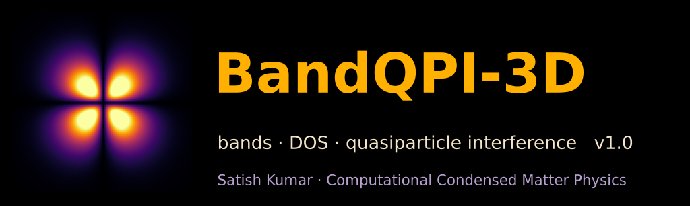

<p align="center"></p>

# BandQPI-3D v1.0

**Bands · DOS · quasiparticle interference from SIESTA / HONPAS Hamiltonians, for molecules, wires, layers and bulk crystals.**

Satish Kumar · Computational Condensed Matter Physics · 97satish02@gmail.com · ORCID 0009-0000-2018-1564

BandQPI-3D reads the converged Hamiltonian and overlap that SIESTA (or HONPAS) writes (`<label>.HSX`) and
diagonalises them again at any k. From those eigenvalues it builds band structures, the density
of states, atom- and orbital-projected bands, 3D band surfaces, constant-energy contours and quasiparticle
interference (QPI) maps. Bands and DOS are never fitted or interpolated: the Hamiltonian is solved at every
k that is shown. The DOS and the Fermi level carry a k-grid error estimate (target ≤ 1 %), and the reported
numbers are checked against SIESTA's own output and against independent recomputation.

---

## 1. Install

You need Linux or macOS, `gfortran` (≥ 9) with OpenMP, LAPACK (OpenBLAS or reference LAPACK), and
Python ≥ 3.9 with `numpy scipy matplotlib pillow`. A run takes from seconds (molecules) to tens of minutes
(large magnetic cells) and writes 10–60 MB.

```bash
unzip BandQPI-3D_v1.0.zip && cd BandQPI-3D_v1.0
bash install.sh              # builds siesta3d.x in this folder
bash install.sh --test       # also runs the exact test suite (section 6), 10–15 minutes
```

Keep `siesta3d.x` and `bandqpi3d.py` in the same folder; a symbolic link to `siesta3d.x` from a folder on
your PATH works (or set `SIESTA3D_HOME` to that folder). On a cluster, `FC=ifx LAPACK_LIBS="-qmkl" bash install.sh`
also works.

## 2. Prepare the SIESTA run

Add one line to your fdf and run SIESTA as usual:

```
SaveHS  true
```

That is all BandQPI-3D needs: the `.HSX` file and the fdf. If the fdf has a `%block BandLines`, that path is
used; otherwise a path through the high-symmetry points of the lattice is built automatically. SIESTA's
own `.bands`, `.DOS`, `.PDOS` and `.EIG`, when present, are compared with BandQPI-3D's numbers in the report.

Supported: SIESTA 4.0 – 5.x HSX (old and versioned formats), HONPAS (hybrid functionals), non-polarised,
collinear spin (nspin 2), non-collinear and spin–orbit (nspin 4 / 8); 0D, 1D, 2D and 3D systems.

## 3. Run

```bash
/path/to/siesta3d.x  system.fdf              # everything, all cores
/path/to/siesta3d.x  system.fdf  -np 8       # limit to 8 cores
```

| option | meaning |
|---|---|
| `-np N` | number of cores |
| `--fast` / `--fine` / `--budget=S` | coarser / finer k grids; the budget (S seconds, default 240) sets the grid sizes and is approximate |
| `--qpi=E1,E2,E3` | energies (eV, relative to E_F) of the contour / QPI maps (1D, 2D, 3D) |
| `--ewin=E1,E2` | energy window of figure 1 |
| `--smear=eV` | Gaussian width used only to *display* the DOS; `dos.dat` holds the unsmeared linear-simplex DOS |
| `--bandcolors=index\|character` | colour of the band lines of the overview figures (figure 1 always: one colour per band) |
| `--kunits=bohr\|ang` | unit of the band-path axis (default Bohr⁻¹, as SIESTA's `.bands`) |
| `--version`, `--help` | |

The output goes to `<label>_3dbands/`, and `<label>_interactive.html` opens in any web browser (offline,
one file).

## 4. What you get

| figure | content |
|---|---|
| 0 validation | every check and its limit, one page |
| 1 bands + DOS | band structure (one colour per band, palette of 15 colours), total and element DOS, gap arrow with value. Magnets: DOS↑ (left, mirrored) · bands↑ · bands↓ · DOS↓, the gap of each spin channel; "metallic" for a gapless channel; half-metals are named |
| 1b projected bands | fat bands: circle area = Mulliken weight of each **atom + orbital shell** (element and n l from the basis, e.g. Mo 4d, S 3p), spin ↑ and ↓ separately, with the matching projected DOS |
| 1e projected bands (atoms) | the same summed per element |
| 2, 3 | 3D band surfaces over the Brillouin zone and zoomed on the smallest gap |
| 4, 5 | dispersion mesh; VBM / CBM surfaces and the local gap map (VASPKIT style) |
| 6, 6c, 7 | constant-energy contours, QPI (Born, JDOS, **spin-conserving JDOS**, **spin-flip JDOS**, Bloch-weighted), peak analysis, QPI dispersion |
| 8 | overview |

The interactive page shows the same data: bands/DOS with atom or atom + orbital projections, spin
selector for magnets, 3D surfaces, contours and every QPI channel (B, Jc, Jf, PK), with PNG/SVG export.

Rules the figures follow (all tested):
* spin channels that agree within 2 meV are a non-magnetic system: shown once, no spin labels;
* a gap arrow is drawn only for a channel with a gap (≥ 20 meV); gapless and metallic channels get none;
* if the user's band path misses the true VBM / CBM, the label says so and gives the on-path value;
* orbital labels are element + n l (s, p, d, f), never px/py/pz.

## 5. Accuracy and validation

Every run writes `validation_report.txt`. It contains

1. **engine checks** — hermiticity of H(k) and S(k), positive-definite S, electron count at E_F,
   agreement with SIESTA's own eigenvalues / DOS / Fermi level, time-reversal and mirror symmetry;
2. **numerical convergence** — the DOS on grids N, N/2 and N/4: the observed order p and the
   Richardson error estimate; the run refines the grid until the estimated error is below 1 %;
3. **figure checks** — every plotted curve is re-read and compared with the data it came from;
4. an **independent audit** (`python3 bandqpi3d.py --audit <folder>`, code separate from the plotting) —
   re-reads the raw files and recomputes the published numbers with different methods.
   `tests/negative_controls.py` damages a finished result on purpose and requires the audit to fail.

All relative limits are 1 % (errors are usually 10⁻³ – 10⁻⁶).

## 6. Test suite with exact answers

`tests/make_models.py` writes SIESTA HSX files of ten tight-binding models whose answers are known in
closed form; `tests/check_models.py` compares BandQPI-3D's output with them using its own,
independent diagonalisation and state counting:

| model | dim | what is checked |
|---|---|---|
| square lattice, one band | 2D metal | bands, E_F, DOS against the elliptic-integral formula |
| staggered honeycomb (hBN-like) | 2D insulator | gap 2Δ at K, band edges, DOS |
| graphene (Δ = 0), automatic path | 2D Dirac | gapless, no arrow, Dirac velocity 3\|t\|d/2ħ |
| SSH chain | 1D | gap 2\|t₁ − t₂\|, DOS |
| CsCl two-orbital crystal | 3D insulator | gap 2Δ on the zone face, DOS |
| spin-split honeycomb, metal ↑ / gap ↓ | 2D half-metal | channel types, gap ↓, moment |
| ferromagnetic insulator | 2D magnet | gap per spin, moment |
| benzene Hückel ring | 0D | all levels 2t cos(2πm/6), HOMO–LUMO gap |
| hBN-like layer, user path missing K | 2D | gap still exact; the figure says the edges lie off the path |
| hBN-like layer in the y–z plane, vacuum as first lattice vector | 2D | periodic directions found, not assumed |

`VALIDATION_v1.0.md` lists the results of this suite (70 exact checks) and of seven real SIESTA / HONPAS
calculations: MoS₂ (2D semiconductor), graphene with HSE06 from HONPAS (old HSX format), a TiO₂ nanowire (1D),
bulk Si (3D), benzene (0D), HfCrBr₂ (2D half-metal) and CrCl₃ (magnet with spin–orbit coupling).
`tests/negative_controls.py` damages a finished result in five ways and requires the audit to catch each.

## 7. Cite

If BandQPI-3D helps your work, please cite it as

> S. Kumar, *BandQPI-3D v1.0: bands, DOS and quasiparticle interference from SIESTA/HONPAS Hamiltonians* (2026).

and the SIESTA method: J. M. Soler *et al.*, J. Phys.: Condens. Matter **14**, 2745 (2002).

## 8. Conventions

* Energies in `summary.txt` and the `.dat` files are relative to SIESTA's E_F unless stated; the DOS is
  per spin channel (states/eV/cell), so a non-polarised total is twice the column.
* For an insulator the code's own Fermi level (`E_F_own_minus_siesta_eV`) is placed mid-gap (T = 0
  convention); for a metal it is the T = 0 charge-neutral level.
* `spinN_gap_eV` is the fundamental (possibly indirect) gap of spin channel N; `spinN_VBM_E_k` /
  `spinN_CBM_E_k` are band edges only when that channel is gapped (`spinN_type`).
* Check the k-points of your `BandLines`: a node written as (0.33, 0.33, 0) is 1 % away from K = (1/3, 1/3, 0).
  Gaps and band edges are always taken from the whole Brillouin zone, never from the path.

## 9. Limits worth knowing

* Projections are Mulliken populations of the SIESTA basis (as SIESTA's PDOS); they are basis-dependent.
* QPI maps are computed from the band structure: JDOS, and the LDOS change of a point impurity in the Born
  approximation (labelled "T-matrix (Born)" in the figures); not a self-consistent impurity calculation.
* The JDOS is spin-diagonal, Σ_σ A_σ(k)A_σ(k+q) (a non-magnetic impurity does not flip the spin); the
  spin-flip channel is shown separately. For a non-magnetic system the spin-flip share is exactly 1/2 and
  the spin-conserving map equals the JDOS, so the figures show them only for magnets and spin–orbit runs.
* Accuracy refers to the SIESTA Hamiltonian, not to experiment; Mulliken weights can be slightly negative.
* For 0D systems the reported E_F is SIESTA's; levels are at Γ only and `--qpi` does not apply.
* For 0D systems only levels at Γ are computed (no k dispersion).
